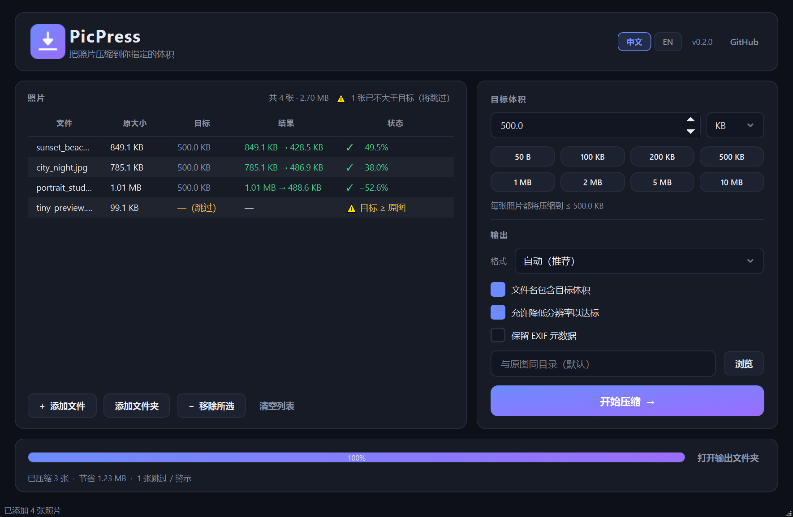
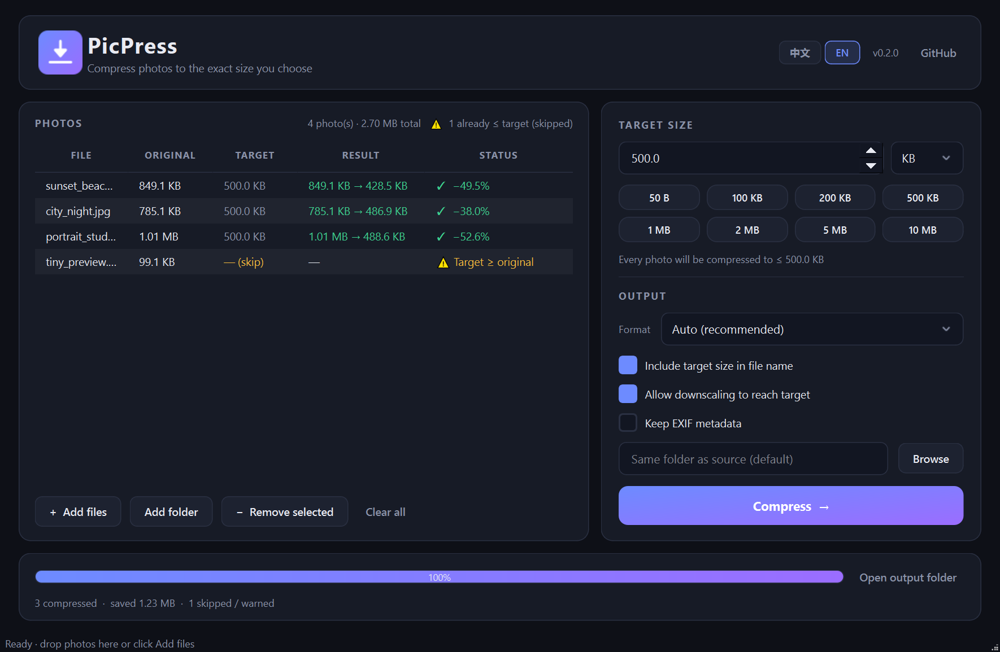
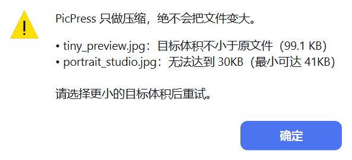

# PicPress

**Compress photos to the exact size you choose.**
把照片压缩到你指定的体积 —— 精确到 B / KB / MB。

[English](README.md) · [简体中文](README.zh-CN.md)

[](LICENSE)
[](#-requirements)
[](pyproject.toml)
[](tests/)

### ⬇️ [Download the latest release](../../releases/latest) · [下载最新版](../../releases/latest)

| Download | Size | Notes |
|---|---|---|
| **PicPress-portable.zip** | ~55 MB | Desktop app — unzip anywhere, run `PicPress.exe` |
| **picpress-mcp-portable.zip** | ~37 MB | Local MCP server for AI agents — unzip, point your client at `picpress-mcp.exe` |

Both are **portable folders**: nothing is installed, no runtime to set up, and
nothing is written to `%TEMP%`. Unzip, run, delete the folder to "uninstall".

No account, no upload, works fully offline.

---

PicPress is a focused image-compression tool: you pick a target file size
(e.g. `500 KB`), and PicPress re-encodes the photo to fit it — with the
**highest quality that meets the target**. If the target is *not* smaller
than the original file, PicPress refuses and tells you why. It never
"compresses" a file into a bigger one.

It ships in two forms:

| Form | What it is | Best for |
|---|---|---|
| **PicPress.exe** | Desktop app with a modern dark UI | Everyday use, sharing with friends |
| **picpress-mcp** | Local [MCP](https://modelcontextprotocol.io) server (stdio) | Letting AI agents compress photos for you |

## ✨ Features

- 🎯 **Exact target size** — type `500` and pick `B`, `KB` or `MB`; or use one-tap presets
- 🚫 **Compression only** — if the target ≥ original size, you get a clear warning instead of a bogus result
- 🔍 **Honest limits** — when a target is unreachable even at minimum quality, PicPress reports the smallest size it *can* achieve
- 🧠 **Smart encoding** — binary-searches JPEG/WebP/PNG quality (and, only if you allow it, a gentle downscale) to land under the target at the best visual quality
- 🈶 **Bilingual UI** — switch between English and 简体中文 instantly; the window rebuilds in place and keeps your files and settings
- 🏷 **Collision-free naming** — outputs carry the target size (`photo_500KB.jpg`, `photo_1MB.jpg`), and repeats get Explorer-style ` (2)` suffixes, so 100 KB and 200 KB runs never overwrite each other
- 🖼 **Explicit format control** — JPG (`.jpg`), JPEG (`.jpeg`), PNG, WebP, or Auto (picks WebP when the image has transparency)
- 🔒 **Privacy-friendly** — EXIF metadata (GPS, camera info) is stripped by default; opt in to keep it
- 📦 **Batch mode** — drop a folder of photos, compress them all to the same target
- 🤖 **MCP server** — five tools agents can call: `compress_image`, `batch_compress`, `estimate_target`, `image_info_tool`, `supported_formats`
- 🪟 **Portable exe** — single-file Windows builds, no installer, no Python required

## 📸 Screenshot



<details>
<summary>English UI / 英文界面</summary>



</details>

<details>
<summary>Warning dialog (light surface, dark text) / 警示弹窗</summary>



</details>

## 🚀 Quick Start (desktop app)

1. Download **`PicPress-portable.zip`** from the [Releases](../../releases) page
2. Unzip it anywhere (Desktop, a USB stick, `D:\Tools\PicPress` — your call)
3. Run `PicPress.exe` inside the folder. No installation.
4. Drag photos in (or **Add files** / **Add folder**), set the target size, hit **Compress**

> Keep the folder together — `PicPress.exe` needs the `_internal` folder next to
> it. To remove the app, just delete the whole folder.
>
> Windows SmartScreen may warn about an unsigned exe — choose
> "More info → Run anyway". Builds are reproducible from source (see below).

### From source

```bash
git clone https://github.com/xiaoqiangzaici/picpress.git
cd picpress
pip install -e ".[all]"        # core + GUI + MCP
python -m picpress             # launch the desktop app
```

## 🤖 MCP Server (for AI agents)

PicPress runs as a local [Model Context Protocol](https://modelcontextprotocol.io)
server over stdio. Agents can then compress photos on your machine with
precise size constraints.

### Option A — use the standalone exe

```json
{
  "mcpServers": {
    "picpress": {
      "command": "C:\\path\\to\\picpress-mcp.exe",
      "args": []
    }
  }
}
```

### Option B — run from source

```json
{
  "mcpServers": {
    "picpress": {
      "command": "python",
      "args": ["-m", "picpress.mcp_server"],
      "env": { "PYTHONPATH": "C:\\path\\to\\picpress\\src" }
    }
  }
}
```

Drop this into your client's MCP config (e.g. Claude Desktop's
`claude_desktop_config.json`, Cursor's `.cursor/mcp.json`, or WorkBuddy's
`~/.workbuddy/mcp.json`).

### Tools

| Tool | Purpose |
|---|---|
| `compress_image` | Compress one image to a target size |
| `batch_compress` | Compress many images to the same target |
| `estimate_target` | Check feasibility *before* compressing |
| `image_info_tool` | Dimensions / format / file size |
| `supported_formats` | List accepted inputs, outputs and units |

All results are structured JSON with a `status` field:
`ok` · `target_too_large` · `unreachable` · `error`.

## 🧪 Testing the MCP server

> **Why does double-clicking `picpress-mcp.exe` show nothing?**
> It is a stdio server, not a GUI app. It starts, then waits silently for a
> client to speak JSON-RPC over stdin/stdout. Seeing "no reaction" is correct.

Three ways to verify it works:

**1. Built-in self-test (no client, no Python needed)**

```bat
picpress-mcp.exe --selftest
```

Runs six checks (create a sample photo, list formats, read info, estimate,
compress, guard rail) and prints a report:

```
[1/6] sample photo .......... ...\picpress-mcp-selftest\sample_photo.jpg  (2.08 MB)
[5/6] compress_image ........ OK  2.08 MB -> 529.3 KB (-75.2%), target 533.0 KB met
[6/6] guard (target 50 MB) .. target_too_large (correctly refused)
RESULT: 6/6 checks passed  —  the MCP server is healthy.
```

On Windows you can also double-click `MCP-自检.bat` next to the exe.

**2. Protocol-level test client (speaks real MCP)**

```bash
python scripts/test_mcp.py            # against dist/picpress-mcp.exe
python scripts/test_mcp.py --python   # against the source tree
```

It performs the handshake, lists tools and calls every one of them, printing
`PASS`/`FAIL` per check and exiting non-zero on failure.

**3. Connect a real agent**

Add the server to your client's MCP config, restart/trust it, then ask the
agent something like *"compress D:\photos\a.jpg to 300 KB"*. The call shows up
as `compress_image` in the client's tool log.

## 📖 How it works

1. The target (e.g. `500 KB`) is converted to bytes
2. **Guard rail:** if target ≥ original file size → `target_too_large`, nothing is written
3. PicPress binary-searches encoder quality (highest quality whose output fits)
4. If quality alone can't reach it and you allowed downscaling, it searches for
   the *least* downscale that fits
5. If still unreachable → `unreachable`, with the smallest achievable size reported

You always get the best-looking file that fits your budget — never bigger,
never silently wrong.

## 🛠 Build it yourself

```bash
pip install -e ".[dev]"
python scripts/build.py          # → dist/PicPress/ + dist/picpress-mcp/ (portable)
python scripts/package.py        # → dist/*.zip + SHA256SUMS.txt
python scripts/build.py --onefile  # optional: single-file exe instead of folders
```

The build runs a smoke test at the end (launches the GUI, handshakes with the MCP
server) and cleans up any temp files it created.

## 🖥 Requirements

- **Prebuilt:** Windows 10 / 11 (x64). Unzip and run — no admin rights, no
  Python, no installer, no runtime.
- **From source:** Python 3.10+ (3.12 / 3.13 recommended) and
  `pip install -e ".[all]"`.
- **macOS / Linux:** the compression engine and the MCP server are pure Python
  and work everywhere; the GUI runs from source with PySide6. Prebuilt binaries
  are Windows-only for now.

## 🔒 Privacy & footprint

PicPress is deliberately boring about your data:

- **Fully offline.** No telemetry, no analytics, no update pings. The only
  network action is the GitHub button in the header *if you click it*.
- **No registry footprint.** No installer, no shell extension, no file
  associations, no startup entries, no background service. Delete the folder and
  it is gone.
- **Your originals are never modified.** PicPress always writes a new file.
- **No temp files.** Released builds are portable folders, which run straight
  from disk — nothing is unpacked to `%TEMP%`.
  (If you build the optional single-file variant yourself with
  `scripts/build.py --onefile`, that one extracts ~134 MB to `%TEMP%\_MEI*` per
  launch and cleans up on a normal exit. That trade-off is why releases ship the
  folder build instead.)

### Uninstall

1. Delete the `PicPress` folder (and `picpress-mcp` if you used the MCP server)
2. Optionally remove the `picpress` entry from your MCP client config
3. Nothing else — no registry keys, no app data folders

## ❓ FAQ

**Windows shows "Windows protected your PC".**
The exe is unsigned (a code-signing certificate costs money). Click
*More info → Run anyway*. Your browser's download history and Windows'
reputation system will make this go away over time.

**Why can't I set a target bigger than the original file?**
Because that isn't compression. PicPress refuses and tells you, instead of
writing a larger file that pretends to be compressed.

**What if my target is impossibly small?**
PicPress reports the smallest size it can actually produce and suggests a
larger target (or enabling downscaling).

**Will it overwrite my files?**
No. Outputs are named `<name>_<target>.<ext>` and repeats get ` (2)`, ` (3)`.
Your originals stay untouched.

**Why is the download a ~55 MB zip instead of a single exe?**
It bundles Python, Qt and Pillow so it runs on a machine with nothing installed.
We ship a folder (zipped) rather than one self-extracting exe on purpose: a
single-file build has to unpack ~134 MB into `%TEMP%` on every launch, and can
leave that folder behind if the process is force-killed. The folder build starts
instantly and writes nothing outside its own directory.

**Can it handle a whole folder?**
Yes — *Add folder* or drag a folder in, everything goes to the same target.

## 📤 Sharing it with others

- **Simplest:** send `PicPress-portable.zip`. The other person unzips it and
  double-clicks `PicPress.exe` — no install, no Python, nothing left behind.
  (Mention the SmartScreen note above.)
- **Nicest:** publish a GitHub Release and share
  `https://github.com/<you>/picpress/releases/latest`.
- **For agent users:** send `picpress-mcp-portable.zip` plus the MCP config
  snippet above; they unzip it, paste the config into their client, restart, and
  can ask their agent to compress photos. Not sure it connected?
  `picpress-mcp.exe --selftest`.

Maintainer notes for releasing a new version live in
[docs/RELEASING.md](docs/RELEASING.md).

## 🧩 Roadmap

- [ ] Resize-to-target-width helper
- [ ] Drag-in-place recompression history / undo
- [ ] macOS & Linux builds in CI
- [ ] Localized UI (EN/ZH switcher)

## 🤝 Contributing

Issues and PRs are welcome. Please keep the core engine (`src/picpress/core.py`)
UI-agnostic — both the desktop app and the MCP server depend on it.

```bash
python tests/test_core.py        # engine unit tests (19)
python tests/test_mcp_server.py  # MCP protocol tests (5)
python tests/test_gui_smoke.py   # GUI smoke tests (4, needs a desktop session)
```

## 📄 License

[MIT](LICENSE) — free for personal and commercial use.

---

*PicPress only compresses. If your target is bigger than the original file,
that's not compression — and PicPress will tell you so.* 
